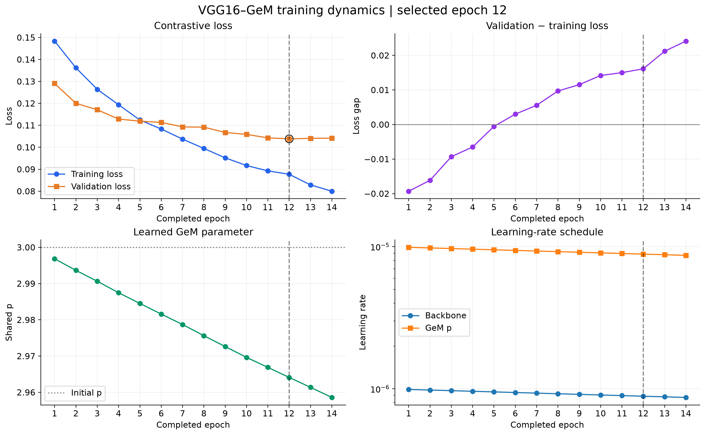
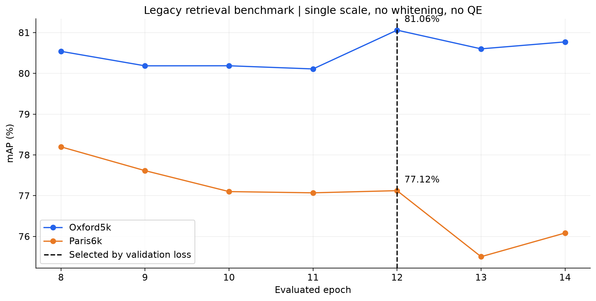
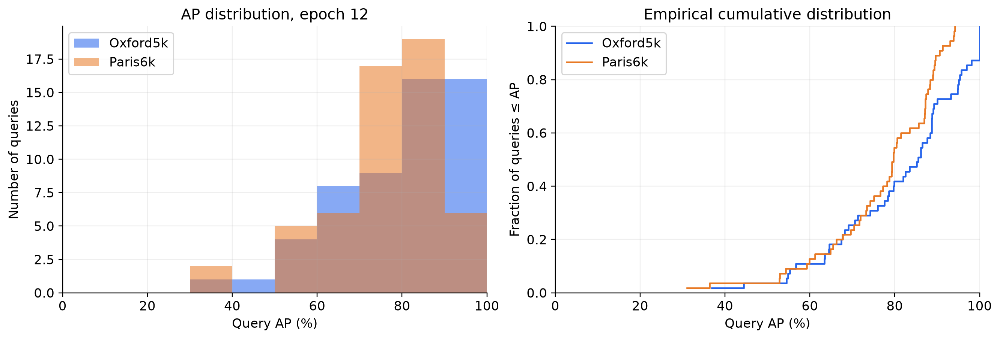

# B0 VGG16–GeM: kết quả checkpoint epoch 12

Nguồn: artifact Kaggle đã lưu; phần thống kê này không chạy lại inference.
Checkpoint chọn theo validation loss: epoch 12, loss 0.103847.
Đã hoàn tất 14/100 epoch trong snapshot.
Training: SfM subset 100 clusters, 15,953 ảnh, seed 42.
Protocol: Oxford5k/Paris6k legacy, resize 1024, single-scale, whitening OFF, QE OFF.

## Kết quả chính

| dataset | epoch | gallery_images | queries | mAP_percent |
| --- | --- | --- | --- | --- |
| Oxford5k | 12 | 5063 | 55 | 81.060 |
| Paris6k | 12 | 6392 | 55 | 77.124 |

## Model học như thế nào?

- Training loss: 0.14836 → 0.08000, giảm 46.1%.
- Validation loss: 0.12907 → 0.10415, giảm 19.3%.
- Validation loss tốt nhất tại epoch 12; tăng nhẹ ở epoch 13–14, chưa đủ kết luận overfitting.
- GeM p ở checkpoint chọn: 2.9641, từ initialization 3.0.
- Mean train/val runtime: 75.5 phút/epoch, không gồm benchmark eval.
- Epoch 15 mới có log từng batch; không đưa vào learning curve như một epoch đã hoàn tất.

## Phân bố độ khó theo query

| dataset | n_queries | mean_AP_percent | median_AP_percent | std_AP_pp | min_AP_percent | q25_AP_percent | q75_AP_percent | max_AP_percent | AP_below_50_count | AP_at_least_90_count |
| --- | --- | --- | --- | --- | --- | --- | --- | --- | --- | --- |
| Oxford5k | 55 | 81.060 | 85.536 | 15.347 | 36.935 | 69.852 | 94.041 | 100.000 | 2 | 16 |
| Paris6k | 55 | 77.124 | 79.693 | 13.776 | 31.054 | 71.001 | 87.609 | 94.153 | 2 | 6 |

## So sánh checkpoint

| dataset | reference_epoch | selected_epoch | delta_mAP_pp | queries_improved | queries_declined | queries_unchanged |
| --- | --- | --- | --- | --- | --- | --- |
| Oxford5k | 8 | 12 | 0.520 | 32 | 15 | 8 |
| Paris6k | 8 | 12 | -1.074 | 22 | 33 | 0 |
| Oxford5k | 14 | 12 | 0.288 | 26 | 21 | 8 |
| Paris6k | 14 | 12 | 1.039 | 38 | 17 | 0 |

## Gợi ý lời nói trên slide

“Nhóm fine-tune VGG16 với GeM pooling trên SfM subset-100. Model được chọn ở epoch 12 dựa trên validation loss thấp nhất, không dựa vào điểm test. Với single-scale và không whitening hay query expansion, checkpoint này đạt mAP 81.06% trên Oxford5k và 77.12% trên Paris6k. Loss giảm rõ trong quá trình học, nhưng test mAP không tăng đều ở mọi epoch. Đây là kết quả reproduction trên subset; chưa có ablation để quy toàn bộ mức hiệu năng cho riêng GeM.”

## Giới hạn

- Không có benchmark trước fine-tuning trong artifact để tính mức tăng so với pretrained model.
- Chưa có ranking/ảnh benchmark ở local, nên phần saved analysis không dựng PR curve hoặc ảnh top-k giả định.
- Query cùng landmark có thể tương quan; thống kê AP là mô tả, không phải kiểm định ý nghĩa thống kê.
- Không đối chiếu trực tiếp với điểm paper nếu chưa khớp training data, protocol và post-processing.
- latest.pt là epoch 14; latest_resume.pt ở ngoài run là epoch 7. Nếu resume, kiểm tra đúng file.
